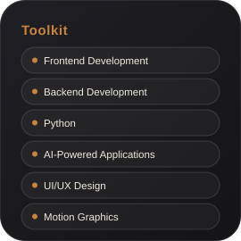

  

  <a href="https://github.com/VisioChroma?tab=repositories"><b>Repositories</b></a> &nbsp;&nbsp;·&nbsp;&nbsp;
  <a href="https://github.com/VisioChroma?tab=stars"><b>Stars</b></a> &nbsp;&nbsp;·&nbsp;&nbsp;
  <a href="https://github.com/VisioChroma/Msword_opensource"><b>Msword_opensource</b></a>

  
  
   
  
  

  

<b>What I like building</b>

 

- AI-powered applications
- Software and web applications
- Mobile experiences
- Robotics and intelligent systems
- Creative digital experiences
- Experimental ideas that may or may not become projects

<b>The creative side</b>

 

UI/UX, visual design, motion, editing, posters, comics and doodles.

<b>How the skyline works</b>

 

One fox per day, standing on a tower. More contributions means a taller tower and a happier fox:
napping, awake, cheerful, smitten, starstruck.
A GitHub Action rebuilds everything every 6 hours from real contribution data.

